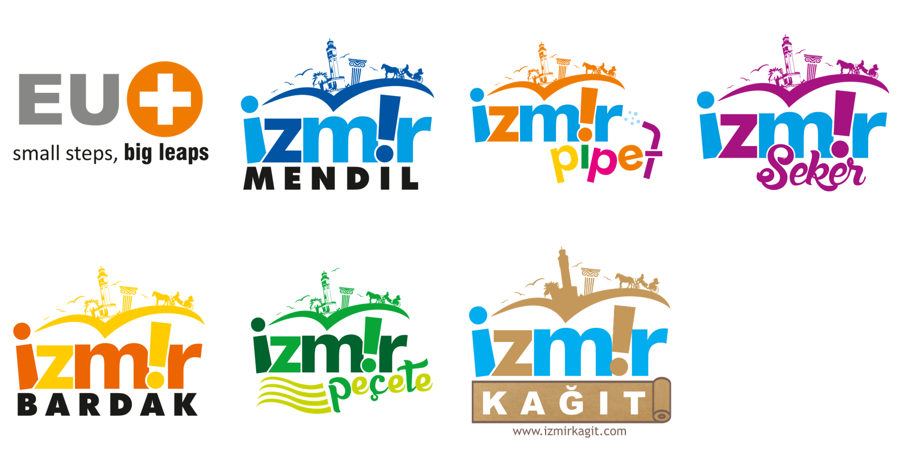

# EUPLUS · Marka Logo Arşivi

EUPLUS Lojistik Ambalaj San. Tic. A.Ş. ve **izm!r** ürün markalarına ait resmî logoların
vektörel (SVG) ve şeffaf arka planlı (PNG) hâlleri. Ayrıca ilan/katalogda kullanılan
[ürün görselleri ve hazır ürün metinleri](urunler/) da bu depoda tutulur.

Logolar, orijinal kartvizit ve marka dosyalarındaki **vektörel eğrilerden** tek tek ayrıştırıldı —
yeniden çizim ya da görüntü büyütme (upscale) yapılmadı. Bu yüzden SVG'ler sonsuz büyütmeye
uygundur ve matbaa kalitesindedir.



## Logolar

| Logo | Klasör | Ana renkler |
|---|---|---|
| EUPLUS (`small steps, big leaps`) | [`logos/euplus`](logos/euplus) | `#878786` `#EF7C00` |
| izm!r **MENDİL** | [`logos/izmir-mendil`](logos/izmir-mendil) | `#0054A3` `#009EE3` |
| izm!r **PİPET** | [`logos/izmir-pipet`](logos/izmir-pipet) | `#EF7C00` `#009EE3` `#FFCC00` `#E5007D` |
| izm!r **ŞEKER** | [`logos/izmir-seker`](logos/izmir-seker) | `#A61380` `#009EE3` |
| izm!r **BARDAK** | [`logos/izmir-bardak`](logos/izmir-bardak) | `#FFCC00` `#EC6502` |
| izm!r **PEÇETE** | [`logos/izmir-pecete`](logos/izmir-pecete) | `#0AA537` `#00622D` `#C7D300` |
| izm!r **KAĞIT** | [`logos/izmir-kagit`](logos/izmir-kagit) | `#C3985A` `#00ADEF` |
| Güzel Tedarik ¹ | [`logos/guzel-tedarik`](logos/guzel-tedarik) | `#D16903` `#000000` |

¹ Güzel Tedarik için vektör (SVG) asıl yok; yalnızca 300×158 px PNG var (`guzel-tedarik.png` şeffaf,
`guzel-tedarik-orijinal.png` beyaz zeminli asıl). Baskı / büyük kullanım için vektör aslı bulunmalı.

## Dosya yapısı

Her logo kendi klasöründe, dört formatta:

```
logos/izmir-mendil/
├── izmir-mendil.svg        ← vektörel, ölçeklenebilir (web + matbaa)
├── izmir-mendil-512.png    ← şeffaf, e-posta imzası / küçük kullanım
├── izmir-mendil-1024.png   ← şeffaf, web / sunum
└── izmir-mendil-2048.png   ← şeffaf, büyük baskı / afiş
```

PNG'lerin **arka planı şeffaftır**; renkli zemin üzerinde de sorunsuz kullanılabilir.
Boyut, logonun uzun kenarını ifade eder.

## Nerede hangisini kullanmalı

- **Web sitesi, e-posta imzası, sosyal medya** → `.svg` (yoksa `-512.png` veya `-1024.png`)
- **Word / PowerPoint / PDF teklif dosyaları** → `-1024.png`
- **Matbaa, ambalaj, afiş, araç giydirme** → `.svg` (tercih edilen) veya `-2048.png`
- **Favicon / uygulama ikonu** → `.svg` üzerinden istenen boyutta dışa aktarın

## Ürün görselleri ve ilan metinleri

İlan, katalog ve teklif dosyaları için ürün fotoğrafları ile hazır açıklama/etiket metinleri
[`urunler/`](urunler/) altındadır. Her ürün kendi klasöründe: 1200×1200 beyaz zeminli JPG
(pazaryeri), şeffaf PNG (kendi siteniz), `urun.json` (yapısal veri) ve `ilan.md` (kopyala-yapıştır
ilan metni). Toplu içe aktarma için [`urunler/urunler.csv`](urunler/urunler.csv).

| Grup | Ürün sayısı | Klasör |
|---|---|---|
| Bardak kılıfı (sleeve) | 2 | [`urunler/`](urunler/#bardak-kılıfı-sleeve--14-oz--16-oz) |
| Sütlü tatlı kapları | 42 | [`urunler/`](urunler/#sütlü-tatlı-kapları-42-ürün) |
| Lokum & çikolata kapları | 30 | [`urunler/`](urunler/#lokum--çikolata-kapları-30-ürün) |
| Bal kapları | 21 | [`urunler/`](urunler/#bal-kapları-21-ürün) |
| Karton bardaklar (sıcak tek/çift katlı, soğuk) | 14 | [`urunler/`](urunler/#paket-servis-ambalajları--72-ürün) |
| Karton kaseler (dondurma, salata) | 17 | [`urunler/`](urunler/#paket-servis-ambalajları--72-ürün) |
| Karton ve oluklu gıda kutuları | 11 | [`urunler/`](urunler/#paket-servis-ambalajları--72-ürün) |
| PET bardak, bardak ve kase kapakları | 21 | [`urunler/`](urunler/#paket-servis-ambalajları--72-ürün) |
| Taşıma viyolü, aksesuar ve kağıt çanta | 9 | [`urunler/`](urunler/#paket-servis-ambalajları--72-ürün) |
| Fast food karton kutular (burger, tavuk, pizza, pasta, noodle), tepsi, kova, kase, bardak | 48 | [`urunler/`](urunler/#fast-food--restoran-ambalajları--79-ürün) |
| Kağıt çantalar, torbalar, ambalaj ve tepsi kağıtları | 11 | [`urunler/`](urunler/#fast-food--restoran-ambalajları--79-ürün) |
| Tamamlayıcı: streç film, sos kabı, ıslak mendil, peçete, filtre, ahşap çatal-bıçak | 20 | [`urunler/`](urunler/#fast-food--restoran-ambalajları--79-ürün) |
| Pastane & kafe kapları (silindir kutu, OPP poşet, pasta-kek, makaron, dondurma, sızdırmaz) | 75 | [`urunler/`](urunler/#gıda-ambalajları-bukap--342-ürün) |
| Kurabiye ve genel gıda kapları (sushi, kaymak, helva, yumurta, peynir, PP kase) | 40 | [`urunler/`](urunler/#gıda-ambalajları-bukap--342-ürün) |
| İçecek bardakları ve şişeler (PET/karton bardak, kapak, PET şişe, viyol, kraft çanta) | 39 | [`urunler/`](urunler/#gıda-ambalajları-bukap--342-ürün) |
| Restoran ve paket servis kapları (mikrodalga, çorba, sos, salata, meze, sandviç) | 76 | [`urunler/`](urunler/#gıda-ambalajları-bukap--342-ürün) |
| Alüminyum kaplar | 18 | [`urunler/`](urunler/#gıda-ambalajları-bukap--342-ürün) |
| Üst film kapama kapları (yemek ve et kapları) | 31 | [`urunler/`](urunler/#gıda-ambalajları-bukap--342-ürün) |
| Tabak ve bardaklar (PP) | 30 | [`urunler/`](urunler/#gıda-ambalajları-bukap--342-ürün) |
| Çatal, kaşık ve bıçak | 33 | [`urunler/`](urunler/#gıda-ambalajları-bukap--342-ürün) |

## Ürün katalogları (PDF)

Dört katalog, aynı görsel dilde; dördü de [`katalog/urunler.json`](katalog/urunler.json) verisinden üretilir:

| Katalog | İçerik | Sayfa | Üretici betik |
|---|---|---|---|
| [**EUPLUS Ürün Kataloğu 2026**](katalog/EUPLUS-Urun-Katalogu-2026.pdf) | 3 bölümde 93 şeffaf sunum ambalajı (sütlü tatlı, lokum-çikolata, bal) | 20 | [`build_katalog.py`](katalog/build_katalog.py) |
| [**EUPLUS Gıda Ambalaj Kataloğu 2026**](katalog/EUPLUS-Gida-Ambalaj-Katalogu-2026.pdf) | 8 bölümde 342 ürün (pastane-kafe, kurabiye ve genel gıda, içecek bardağı ve şişe, restoran-paket servis, alüminyum, üst film kapama, tabak-bardak, çatal-kaşık-bıçak); Crystal Pack kataloğuyla aynı format | 60 | [`build_katalog.py gida`](katalog/build_katalog.py) |
| [**EUPLUS Paket Servis Kataloğu 2026**](katalog/EUPLUS-Paket-Servis-Katalogu-2026.pdf) | 14 bölümde 72 paket servis ambalajı (karton bardak, kase, kutu, kapak, viyol, kağıt çanta) | 19 | [`build_katalog_servis.py`](katalog/build_katalog_servis.py) |
| [**EUPLUS Fast Food & Restoran Ambalajları Kataloğu 2026**](katalog/EUPLUS-Fast-Food-Katalogu-2026.pdf) | 25 bölümde 79 ürün / 256 ölçü (burger-tavuk-pizza-pasta kutuları, tepsi, kova, kase, bardak, kağıt çanta ve torbalar, ambalaj kağıdı, tamamlayıcı ürünler) | 36 | [`build_katalog_fastfood.py`](katalog/build_katalog_fastfood.py) |

## Doğrudan bağlantı (hotlink)

Bu depo public olduğu için logolar doğrudan bağlanabilir:

```html

```

## Kullanım kuralları

- Logoların **en/boy oranını** koruyun; yatay veya dikey olarak esnetmeyin.
- Renkleri değiştirmeyin, gölge/kontur/efekt eklemeyin.
- Logonun etrafında, `izm!r` yazısının yüksekliği kadar **boş alan** bırakın.
- Karmaşık fotoğraf üzerine yerleştirmeyin; sade ve yeterli kontrastlı zemin kullanın.
- Minimum genişlik: ekranda **80 px**, baskıda **20 mm**.

## Telif

Bu logolar EUPLUS Lojistik Ambalaj San. Tic. A.Ş.'ye ait tescilli marka varlıklarıdır.
Depo, kurum içi ve iş ortaklarıyla paylaşım kolaylığı için herkese açıktır; ancak
logoların üçüncü taraflarca kullanımı şirketin yazılı iznine tabidir.

---

**EUPLUS Lojistik Ambalaj San. Tic. A.Ş.**
Mersinli Mah. 2829 Sokak No:3, 1. Sanayi Sitesi — 35170 İzmir / TÜRKİYE
Tel: +90 232 421 41 41 · Faks: +90 232 421 41 66 · [euplus.com.tr](https://www.euplus.com.tr)
